	<picture>
		<source media="(prefers-color-scheme: dark)" srcset="./dark.svg">
		<source media="(prefers-color-scheme: light)" srcset="./light.svg">
		
	</picture>

<h2 align="center">📊 Current Stats</h2>

	<picture>
		<source media="(prefers-color-scheme: dark)" srcset="https://github-profile-summary-cards.vercel.app/api/cards/stats?username=sa-rafsan&amp;theme=github_dark">
		<source media="(prefers-color-scheme: light)" srcset="https://github-profile-summary-cards.vercel.app/api/cards/stats?username=sa-rafsan&amp;theme=default">
		
	</picture>
	<picture>
		<source media="(prefers-color-scheme: dark)" srcset="https://github-profile-summary-cards.vercel.app/api/cards/repos-per-language?username=sa-rafsan&amp;theme=github_dark">
		<source media="(prefers-color-scheme: light)" srcset="https://github-profile-summary-cards.vercel.app/api/cards/repos-per-language?username=sa-rafsan&amp;theme=default">
		
	</picture>
	<picture>
		<source media="(prefers-color-scheme: dark)" srcset="https://github-profile-summary-cards.vercel.app/api/cards/productive-time?username=sa-rafsan&amp;theme=github_dark&amp;utcOffset=6">
		<source media="(prefers-color-scheme: light)" srcset="https://github-profile-summary-cards.vercel.app/api/cards/productive-time?username=sa-rafsan&amp;theme=default&amp;utcOffset=6">
		
	</picture>

	<picture>
		<source media="(prefers-color-scheme: dark)" srcset="https://github-profile-summary-cards.vercel.app/api/cards/profile-details?username=sa-rafsan&amp;theme=github_dark">
		<source media="(prefers-color-scheme: light)" srcset="https://github-profile-summary-cards.vercel.app/api/cards/profile-details?username=sa-rafsan&amp;theme=default">
		
	</picture>

<h2 align="center">🛠️ Technical Skills</h2>

<h3 align="center">Languages & Web</h3>

<table align="center">
	<tr>
		<td align="center" width="96">
			 
			C#
		</td>
		<td align="center" width="96">
			 
			C++
		</td>
		<td align="center" width="96">
			 
			Go
		</td>
		<td align="center" width="96">
			 
			JavaScript
		</td>
		<td align="center" width="96">
			 
			TypeScript
		</td>
		<td align="center" width="96">
			 
			HTML5
		</td>
		<td align="center" width="96">
			 
			CSS3
		</td>
	</tr>
</table>

<h3 align="center">Frameworks & Libraries</h3>

<table align="center">
	<tr>
		<td align="center" width="96">
			 
			.NET
		</td>
		<td align="center" width="96">
			 
			React
		</td>
		<td align="center" width="96">
			 
			Redux
		</td>
		<td align="center" width="96">
			<picture>
				<source media="(prefers-color-scheme: dark)" srcset="https://cdn.simpleicons.org/nextdotjs/ffffff">
				<source media="(prefers-color-scheme: light)" srcset="https://cdn.simpleicons.org/nextdotjs/000000">
				
			</picture> 
			Next.js
		</td>
		<td align="center" width="96">
			 
			Tailwind
		</td>
		<td align="center" width="96">
			 
			Bootstrap
		</td>
		<td align="center" width="96">
			 
			jQuery
		</td>
	</tr>
</table>

<h3 align="center">Databases</h3>

<table align="center">
	<tr>
		<td align="center" width="96">
			 
			SQL Server
		</td>
		<td align="center" width="96">
			 
			MySQL
		</td>
		<td align="center" width="96">
			 
			PostgreSQL
		</td>
		<td align="center" width="96">
			 
			Oracle
		</td>
		<td align="center" width="96">
			 
			MongoDB
		</td>
	</tr>
</table>

<h3 align="center">Cloud & Tools</h3>

<table align="center">
	<tr>
		<td align="center" width="96">
			 
			Azure
		</td>
		<td align="center" width="96">
			 
			Docker
		</td>
		<td align="center" width="96">
			 
			Git
		</td>
		<td align="center" width="96">
			<picture>
				<source media="(prefers-color-scheme: dark)" srcset="https://cdn.simpleicons.org/github/ffffff">
				<source media="(prefers-color-scheme: light)" srcset="https://cdn.simpleicons.org/github/181717">
				
			</picture> 
			GitHub
		</td>
		<td align="center" width="96">
			 
			GitLab
		</td>
		<td align="center" width="96">
			 
			Visual Studio
		</td>
		<td align="center" width="96">
			 
			VS Code
		</td>
		<td align="center" width="96">
			 
			JWT
		</td>
	</tr>
</table>

 

	Curious by default. Building in public.

