	<picture>
		<source media="(prefers-color-scheme: dark)" srcset="./dark.svg">
		<source media="(prefers-color-scheme: light)" srcset="./light.svg">
		
	</picture>

## Hello

I'm Rafsan Bhuiyan. I build and share creative development work, experiments, and ideas in public.

## Connect

- [GitHub](https://github.com/sa-rafsan)
- [LinkedIn](https://www.linkedin.com/in/rafsan-bhuiyan-44305a235)
- [Instagram](https://www.instagram.com/CuriousRafsan)
- [YouTube](https://www.youtube.com/@CuriousRafsan)

## Contribution Snake

	<picture>
		<source media="(prefers-color-scheme: dark)" srcset="https://raw.githubusercontent.com/sa-rafsan/sa-rafsan/output/github-snake-dark.svg">
		<source media="(prefers-color-scheme: light)" srcset="https://raw.githubusercontent.com/sa-rafsan/sa-rafsan/output/github-snake.svg">
		
	</picture>

	Curious by default. Building in public.

