	<picture>
		<source media="(prefers-color-scheme: dark)" srcset="./dark.svg">
		<source media="(prefers-color-scheme: light)" srcset="./light.svg">
		
	</picture>

<h2 align="center">📊 Current Stats</h2>

	<picture>
		<source media="(prefers-color-scheme: dark)" srcset="https://github-profile-summary-cards.vercel.app/api/cards/stats?username=sa-rafsan&amp;theme=github_dark">
		<source media="(prefers-color-scheme: light)" srcset="https://github-profile-summary-cards.vercel.app/api/cards/stats?username=sa-rafsan&amp;theme=default">
		
	</picture>
	<picture>
		<source media="(prefers-color-scheme: dark)" srcset="https://github-profile-summary-cards.vercel.app/api/cards/repos-per-language?username=sa-rafsan&amp;theme=github_dark">
		<source media="(prefers-color-scheme: light)" srcset="https://github-profile-summary-cards.vercel.app/api/cards/repos-per-language?username=sa-rafsan&amp;theme=default">
		
	</picture>
	<picture>
		<source media="(prefers-color-scheme: dark)" srcset="https://github-profile-summary-cards.vercel.app/api/cards/productive-time?username=sa-rafsan&amp;theme=github_dark&amp;utcOffset=6">
		<source media="(prefers-color-scheme: light)" srcset="https://github-profile-summary-cards.vercel.app/api/cards/productive-time?username=sa-rafsan&amp;theme=default&amp;utcOffset=6">
		
	</picture>

	<picture>
		<source media="(prefers-color-scheme: dark)" srcset="https://github-profile-summary-cards.vercel.app/api/cards/profile-details?username=sa-rafsan&amp;theme=github_dark">
		<source media="(prefers-color-scheme: light)" srcset="https://github-profile-summary-cards.vercel.app/api/cards/profile-details?username=sa-rafsan&amp;theme=default">
		
	</picture>

	Curious by default. Building in public.

